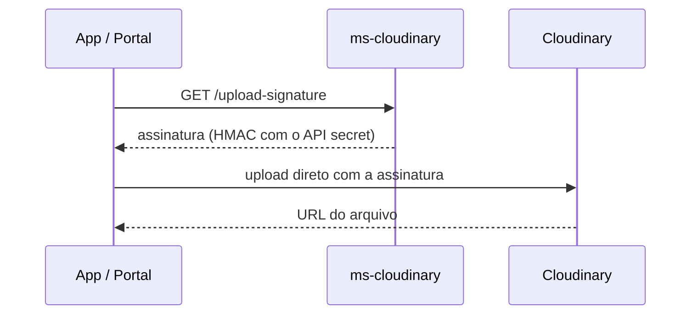

# Aether MS Cloudinary

Microsserviço de mídia do [Aether](https://github.com/AetherGases). Ele **não recebe os arquivos**: apenas emite uma **assinatura de upload** para que o cliente (app ou portal) envie a imagem ou planilha direto ao Cloudinary. Não tem banco de dados.

O [Kong](https://github.com/AetherGases/aether-kong-gateway) encaminha `/api/cloudinary` para este serviço.

## Rota

| Método e rota | Descrição |
| --- | --- |
| `GET /api/cloudinary/upload-signature?fileType=IMAGE` | Devolve os parâmetros assinados (timestamp, pasta, assinatura, API key) para um upload direto. `fileType` segue o enum `StorageFileTypeEnum` |

Swagger em `/swagger-ui/index.html`.



O hub de IA também usa essa rota (com a chave interna) para montar o fluxo de envio de inventários pelo ChatGPT.

## Autenticação

Todas as rotas `/api/**` exigem **uma** das duas credenciais:

1. Header `authentication-key` com `INTERNAL_AUTHENTICATION_KEY` (chamadas entre serviços).
2. Sem esse header, um access token JWT do `ms-auth` em `Authorization: Bearer <token>`.

O JWT é validado de forma stateless (assinatura HMAC256 com `JWT_SECRET`, expiração e claims), sem consultar banco, e **refresh tokens são rejeitados**. Se o header `authentication-key` for enviado, ele tem prioridade e o JWT é ignorado. Requisição sem credencial, com chave inválida ou token inválido devolve `401`.

## Stack

Java 21, Spring Boot 4.1, Spring Security, SDK do Cloudinary, SpringDoc OpenAPI, Maven, JUnit 5 e Mockito.

```text
src/main/java/com/aether/ms_cloudinary
├── cloudinary/   # controller, service, mapper e DTOs da assinatura
└── shared/       # security (AuthenticationKeyFilter, JwtTokenFilter), config, exceptions, handlers
```

## Executando localmente

Pré-requisitos: Java 21 e Maven 3.9+. Não precisa de banco.

```bash
git clone https://github.com/AetherGases/aether-ms-cloudinary.git
cd aether-ms-cloudinary
cp .env.example .env
mvn spring-boot:run
```

| Variável | Descrição |
| --- | --- |
| `API_PORT`, `SPRING_PROFILES_ACTIVE` | Porta (padrão `8080`) e perfil |
| `CLOUDINARY_CLOUD_NAME/API_KEY/API_SECRET` | Credenciais da conta Cloudinary |
| `INTERNAL_AUTHENTICATION_KEY` | Chave compartilhada com os demais serviços |
| `JWT_SECRET` | **O mesmo** segredo do `ms-auth` |
| `BREVO_*` | Presentes por herança do esqueleto; o serviço não envia e-mails |

## Testes e deploy

`mvn clean compile test -DskipTests=false` roda no CI. Publicar uma **release** dispara o deploy no EKS pelo workflow compartilhado da organização ([.github](https://github.com/AetherGases/.github)). Na produção, o Secret `aether-env` entrega as variáveis.

## Pontos de atenção

- `spring.application.name` está como `core-api` e existe uma exceção `CoreApiException`, ambos herdados do monólito arquivado.
- O `application.yml` exige `BREVO_API_KEY` e variáveis semelhantes mesmo sem usá-las; sem elas o serviço não sobe.
